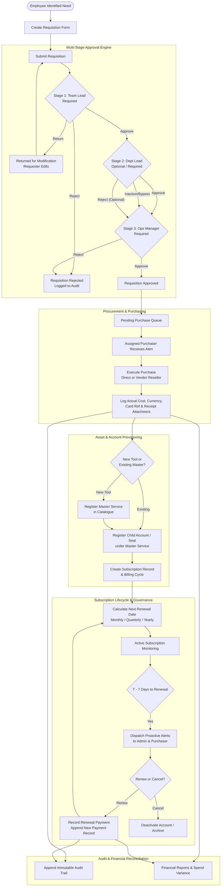
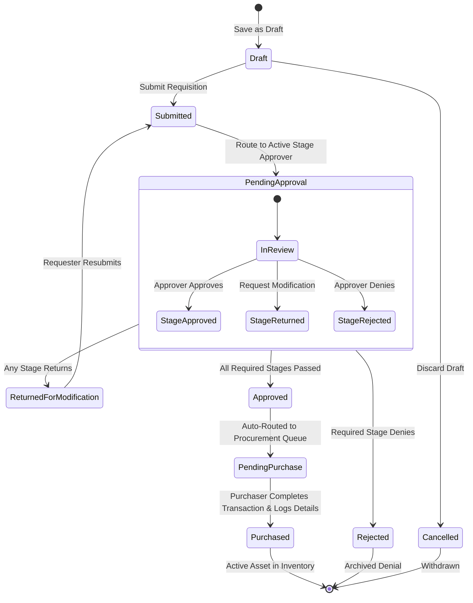
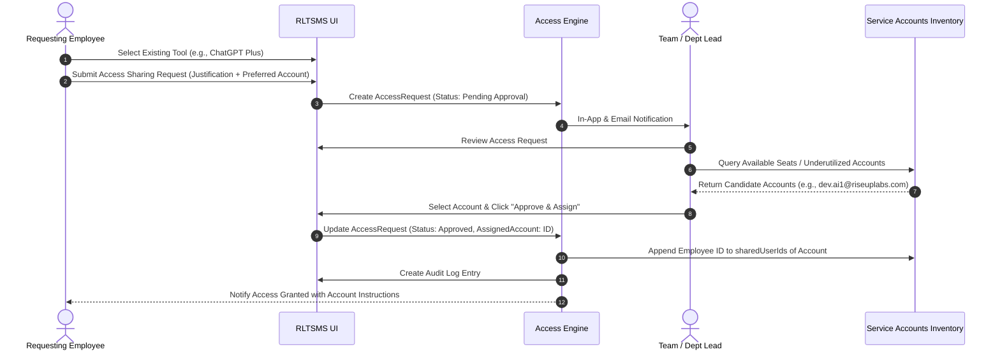
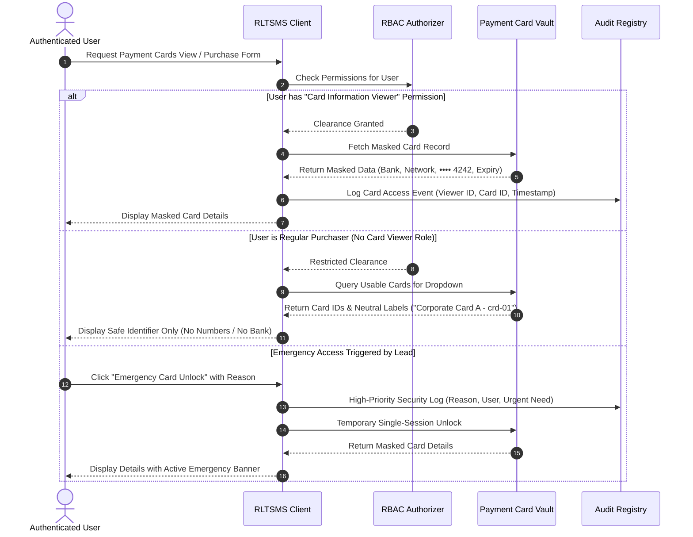
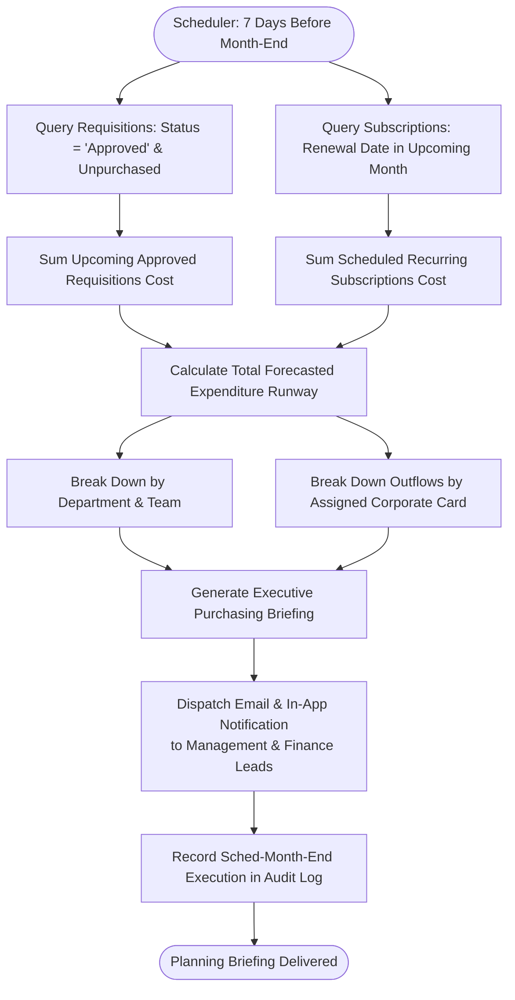
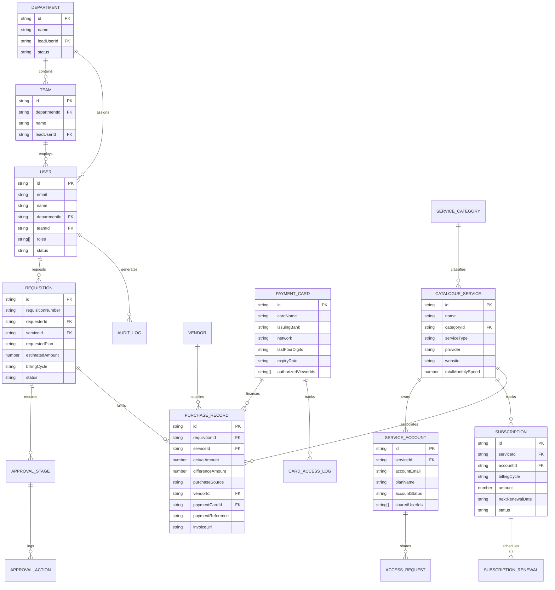

# RLTSMS – System Architecture & Lifecycle Flows

**System Name:** RLTSMS (Riseup Labs Tools & Services Management System)  
**Slogan:** *Your Tools. Your Services. Every Stage, Tracked*  
**Document:** System Workflow & Technical Flow Specifications  
**Version:** 2.0.0-PROD  

---

## 1. End-to-End Procurement Lifecycle Flow

This flowchart illustrates the complete lifecycle of a software tool or digital service in RLTSMS—from initial employee requisition through approval, procurement, account provisioning, renewal tracking, and financial reconciliation.

---

## 2. Approval Workflow Engine State Machine

The state machine below details the valid states, transitions, and guard conditions for requisitions in RLTSMS.

---

## 3. Access Sharing & Seat Pooling Flow

When an employee needs access to an existing tool (e.g., ChatGPT Plus, Figma, Envato Elements), they request a shared seat instead of procuring a duplicate paid license.

---

## 4. Zero-Trust Payment Card Governance Flow

This sequence demonstrates how payment cards are secured, ensuring sensitive financial information is insulated from general system access.

---

## 5. Automated 7-Day Pre-Month-End Planning & Renewal Cadence

RLTSMS runs background schedules to ensure executive budget transparency before any calendar month closes.

---

## 6. Relational Data Architecture (Entity Relationship Diagram)

RLTSMS utilizes a clean relational architecture where master entities link seamlessly to transactional and operational children.

