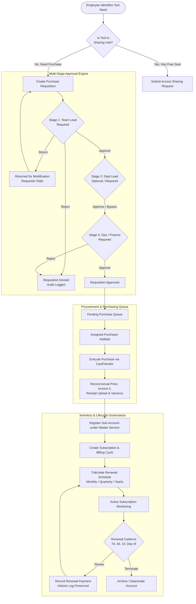
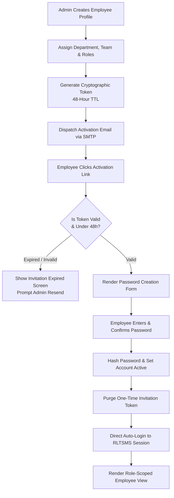
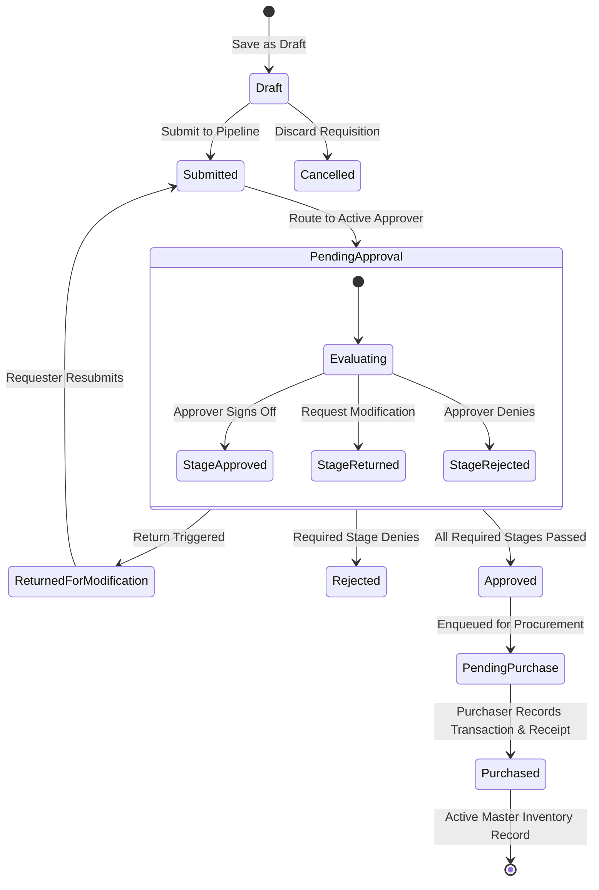
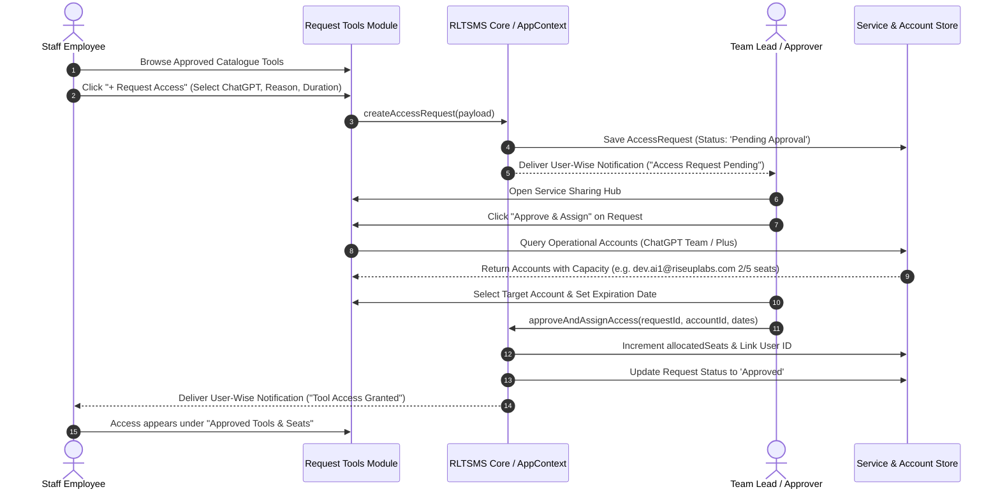
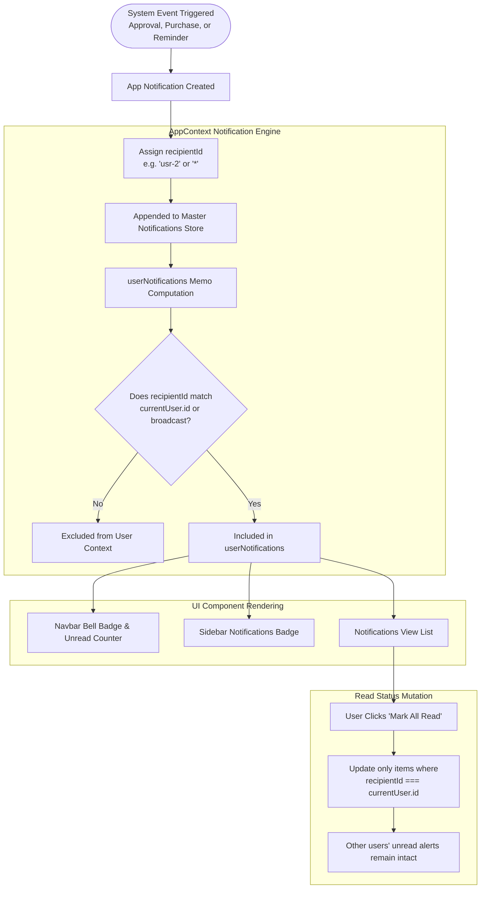
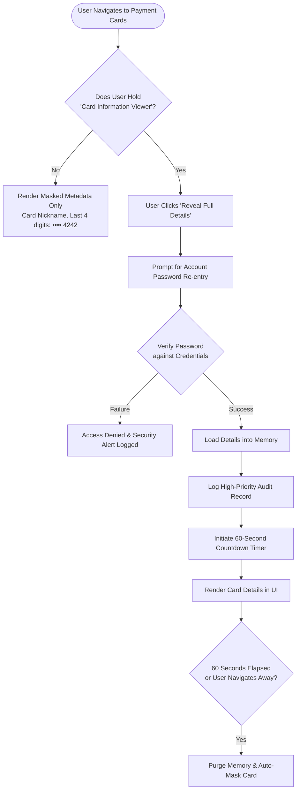

# RLTSMS – Master Product Requirements Document (PRD) & Workflow Specification

**System Name:** RLTSMS (Riseup Labs Tools & Services Management System)  
**Slogan:** *Your Tools. Your Services. Every Stage, Tracked*  
**Document Type:** Master Enterprise PRD & Comprehensive System Workflow Specification  
**Version:** 2.2.0-PROD  
**Target Organization:** Riseup Labs  
**Classification:** Internal Enterprise Specification & Architectural Reference  
**Status:** Approved & Live in Production  

---

## Table of Contents
1. [Executive Summary & Vision](#1-executive-summary--vision)
2. [System Architecture & Technology Stack](#2-system-architecture--technology-stack)
3. [Role-Based Access Control (RBAC) & Dynamic Permissions Matrix](#3-role-based-access-control-rbac--dynamic-permissions-matrix)
4. [Organization Hierarchy & Employee Lifecycle Workflow](#4-organization-hierarchy--employee-lifecycle-workflow)
5. [Master Services & Tools Catalogue Taxonomy](#5-master-services--tools-catalogue-taxonomy)
6. [Multi-Stage Approval Workflow Engine](#6-multi-stage-approval-workflow-engine)
7. [Purchase Requisition & Procurement Lifecycle](#7-purchase-requisition--procurement-lifecycle)
8. [Access-Sharing Hub & Seat Management ("Request Service/Tools")](#8-access-sharing-hub--seat-management-request-servicetools)
9. [Zero-Trust Payment Card Governance Vault](#9-zero-trust-payment-card-governance-vault)
10. [Intelligent User-Wise Notifications & Alert Engine](#10-intelligent-user-wise-notifications--alert-engine)
11. [Spend Analytics, Financial Reports & Fiscal Year Governance](#11-spend-analytics-financial-reports--fiscal-year-governance)
12. [System Email Engine & Templating](#12-system-email-engine--templating)
13. [Immutable Audit Ledger & Observability](#13-immutable-audit-ledger--observability)
14. [Comprehensive System Workflow Diagrams (Mermaid)](#14-comprehensive-system-workflow-diagrams-mermaid)
15. [Data Models & Schema Specifications](#15-data-models--schema-specifications)
16. [Acceptance Criteria & Verification Matrix](#16-acceptance-criteria--verification-matrix)

---

## 1. Executive Summary & Vision

### 1.1 Product Statement
**RLTSMS** is Riseup Labs' centralized internal enterprise platform for digital asset governance, procurement lifecycle tracking, software subscription monitoring, and financial expenditure accountability. It bridges the gap between technical tool requests, executive/departmental approvals, procurement execution, zero-credential seat sharing, and recurring billing renewals:

$$\text{Requisition} \longrightarrow \text{Multi-Stage Approval} \longrightarrow \text{Procurement} \longrightarrow \text{Provisioning} \longrightarrow \text{Sharing Hub} \longrightarrow \text{Renewal Alerting} \longrightarrow \text{Audit \& Spend Analysis}$$

### 1.2 Core Brand Slogan
> **"Your Tools. Your Services. Every Stage, Tracked"**

Every digital asset—from individual developer IDE extensions, AI subscriptions, and design seats to multi-thousand-dollar cloud infrastructure nodes and enterprise domains—is catalogued, authorized via customized approval workflows, purchased with audit-safe payment cards, pooled for employee access sharing, and proactively renewed.

### 1.3 Key Objectives
1. **Single Source of Truth:** Eliminate spreadsheet tracking and untracked SaaS licenses across departments.
2. **Prevent Redundant Spend & Ghost Subscriptions:** Enable internal zero-credential seat pooling before new licenses are procured.
3. **Customizable Approval Workflows:** Visual drag-and-drop workflow configuration supporting required approvers, optional reviewers, and role-based or user-specific assignments.
4. **Zero-Trust Corporate Card Vault:** Strict isolation of corporate payment methods. Card numbers and security codes are never stored; only masked metadata is viewable by authorized personnel upon ephemeral password re-verification.
5. **Accurate Budget Variance:** Track Original Request $\to$ Approved Budget $\to$ Actual Purchase Price to identify cost variances and optimize fiscal planning.
6. **User-Wise Alerting & Month-End Briefing:** Alert users strictly on alerts relevant to their account, with automated subscription renewal cadences ($T-7, T-3, T-1, \text{Day-of}$) and monthly purchase forecasting for finance leadership.

### 1.4 Product Boundaries & Anti-Scope
* **Not an HRMS/EMS:** Does not handle payroll, attendance, leave, or employee performance. Employee accounts exist purely to identify requesters, approvers, license holders, and purchasers.
* **Not a Project/Task Tracker:** Does not manage sprints, issues, or code commits.
* **Not a Payment Gateway:** Does not directly charge credit cards via payment processors; it registers and reconciles verified corporate purchases, transaction references, and payment cards.

---

## 2. System Architecture & Technology Stack

### 2.1 Technology Stack Matrix
* **Frontend Application:** React 19, TypeScript (Strict Mode), Vite 8.3+, Tailwind CSS v4, Lucide React icons.
* **State Management & Offline Capability:** Custom React Context (`AppContext`) featuring local browser storage caching with automated prefix migration (`estms_` $\to$ `rltsms_`).
* **Backend & Edge Runtime:** Cloudflare Workers (Edge runtime) with static asset routing and Node.js REST API server fallback.
* **Email & Notifications:** SMTP Mailer engine supporting variable interpolation, tokenized activation links, and automated scheduling.
* **Testing & Quality Assurance:** Native Node.js test runner (`node:test`, `node:assert/strict`) via `tsx` runner with 37+ automated test suites.

### 2.2 Security Architecture
* **Strict Session Authentication:** Token-based session authentication with optional persistent "Remember Me" storage.
* **Password Hashing & Protection:** SHA-256 client/server cryptographic hashing with salt fallbacks.
* **Data Sanitization:** Strict HTML escaping, parameterized query abstractions, and zero exposure of sensitive card or API tokens.

---

## 3. Role-Based Access Control (RBAC) & Dynamic Permissions Matrix

RLTSMS features a comprehensive dynamic RBAC engine. Users can hold multiple roles simultaneously. System modules, navigation links, and action buttons appear or disappear dynamically based on the logged-in user's computed permissions.

### 3.1 Standard System Roles

| Role Name | Description | Default Permissions |
| :--- | :--- | :--- |
| **Super Admin** | Full executive platform owner with complete system authority. | Wildcard `['*']` (All modules and actions) |
| **System Admin** | Operational administrator managing users, organization units, catalogue, and workflows. | `services:*`, `accounts:*`, `org:*`, `workflows:write`, `rbac:*`, `settings:manage`, `reports:view`, `audit:view` |
| **Employee** | Standard staff member focused on requesting access to approved tools. | `dashboard:view`, `access:request` |
| **Team Lead** | First-line technical lead reviewing team purchase requisitions and access requests. | `dashboard:view`, `requisitions:view`, `requisitions:submit`, `approvals:team`, `access:view`, `access:request`, `access:approve`, `org:view` |
| **Department Lead** | Department head approving departmental budgets and requisitions. | `dashboard:view`, `requisitions:view`, `requisitions:submit`, `approvals:department`, `access:view`, `access:request`, `access:approve`, `org:view`, `reports:view` |
| **Operation Manager** | Operational executive evaluating company-wide software fit and budget. | `dashboard:view`, `requisitions:view`, `approvals:operations`, `purchases:view`, `org:view`, `reports:view`, `access:view`, `access:approve` |
| **Purchaser** | Corporate procurement officer fulfilling approved requisitions and registering accounts. | `dashboard:view`, `requisitions:view`, `purchases:view`, `purchases:write`, `accounts:view`, `accounts:write`, `cards:view_masked`, `subscriptions:view`, `reports:view` |
| **Finance** | Financial controller auditing invoices, recording payments, and analyzing spend variance. | `dashboard:view`, `finance:view`, `expenses:view`, `expenses:write`, `purchases:view`, `subscriptions:view`, `reports:view` |
| **Management** | C-Level leadership viewing high-level financial KPIs and executive summaries. | `dashboard:view`, `dashboard:executive`, `reports:view`, `org:view`, `finance:view`, `subscriptions:view` |
| **Card Information Viewer** | Specifically authorized security officer permitted to view masked card credentials. | `cards:view_masked`, `cards:reveal_full`, `reports:view` *(Not inherited by Super Admin or Finance)* |

### 3.2 Granular Permission Codes Registry (35 Codes)

```
Dashboard:
  - dashboard:view         : Access standard dashboard and analytics
  - dashboard:executive    : View high-level cross-departmental financial KPIs

Requisitions & Approvals:
  - requisitions:view      : View purchase requisition records
  - requisitions:submit    : Submit new purchase requisitions
  - requisitions:manage    : Cancel, edit, or override purchase requisitions
  - approvals:team         : Review and approve Level 1 Team Lead stages
  - approvals:department   : Review and approve Level 2 Department Lead stages
  - approvals:operations   : Provide operational and budgetary sign-offs
  - approvals:finance      : Authorize financial disbursements

Services Catalogue & Accounts:
  - services:view          : Browse approved catalogue services and tools
  - services:write         : Add, update, or archive catalogue services & plans
  - accounts:view          : View software accounts and seat assignments
  - accounts:write         : Register service accounts and manage license seats

Access Sharing Hub:
  - access:view            : View shared accounts, events, and access allocations
  - access:request         : Submit access requests for company shared software seats
  - access:approve         : Review and approve employee access sharing requests
  - access:assign          : Assign, extend, or revoke shared account seats

Procurement & Subscriptions:
  - purchases:view         : View procurement logs and purchase records
  - purchases:write        : Complete purchases, record invoices, register accounts
  - subscriptions:view     : Track subscription renewals and billing cycles
  - subscriptions:write    : Update renewal terms, cancel, record recurring payments

Finance & Payment Cards:
  - expenses:view          : View company tool and subscription expenditures
  - expenses:write         : Record and categorize expenditures
  - finance:view           : Access financial variance and forecasting reports
  - cards:view_masked      : View masked card metadata (bank, network, last 4)
  - cards:reveal_full      : Ephemerally reveal card details via password re-entry
  - cards:manage           : Create, update, or assign permissions for corporate cards

Organization & Governance:
  - org:view               : View department structure, teams, and employee roster
  - org:manage             : Create, edit, delete departments, teams, invite employees
  - rbac:view              : View role definitions and permissions matrix
  - rbac:manage            : Create, edit, and delete dynamic roles and permissions
  - workflows:write        : Design and customize multi-stage approval workflows
  - reports:view           : Generate and export CSV reports and analytics
  - audit:view             : Inspect immutable security and activity ledger
  - settings:manage        : Configure system parameters and email templates
```

### 3.3 Dynamic UI Visibility Logic
* If an employee possesses only `['Employee']` (permissions `dashboard:view`, `access:request`):
  * **Sidebar:** Only displays **Dashboard**, **Request Service/Tools**, and **Notifications**.
  * **Hidden Navigation:** Requisitions, Approvals, Services, Accounts, Sharing Hub, Purchases, Subscriptions, Cards, Organization, RBAC, Reports, Audit, Settings are completely removed.
  * **Action Buttons:** "+ New Requisition", "Approve", "Add Employee", "Edit Workflow" are hidden automatically.

---

## 4. Organization Hierarchy & Employee Lifecycle Workflow

### 4.1 3-Tier Enterprise Structure
$$\text{Riseup Labs} \longrightarrow \text{Departments} \longrightarrow \text{Teams} \longrightarrow \text{Employees}$$

* **Departments:** High-level divisions led by an appointed Department Lead (e.g., Engineering, Creative & Design, Quality Assurance, Product & Operations, Finance & Admin).
* **Teams:** Functional units within a department led by a Team Lead (e.g., Frontend Web, Mobile Apps, AI Research, UI/UX Design, Automation QA).
* **Employees:** Staff members mapped to a primary Department and Team, assigned specific system roles, contact information, and an account status.

### 4.2 Seamless Employee Onboarding & Activation Flow

```
Admin creates employee profile with roles
            │
            ▼
Generate cryptographic invitation token (48h expiry)
            │
            ▼
Send Activation Email with URL (/activate?token=...)
            │
            ▼
Employee clicks activation link
            │
            ▼
Token verified server-side (Check expiration & status)
            │
            ▼
Employee enters & confirms new account password
            │
            ▼
Account activated: status switches to 'Active', token purged
            │
            ▼
Direct auto-login into user session (No manual re-login required)
```

1. **Zero-Password Invitation:** Admin does not choose or know the employee's initial password.
2. **Cryptographic Token:** A unique 64-character token is generated with a 48-hour expiration timestamp.
3. **Dedicated Activation View:** Directing to `/#/activate?token=...` checks validity. If expired, an alert notifies the employee to contact administrators for a refreshed invitation.
4. **Resend Capability:** Administrators can re-send invitations with a single click, which invalidates prior tokens and regenerates a fresh 48-hour window without duplicating employee records.
5. **Self-Service Password Creation:** Employee sets their confidential password, activating their account and transitioning directly into the system.

---

## 5. Master Services & Tools Catalogue Taxonomy

The catalogue organizes all digital tools and online cloud infrastructure into 17 standardized categories across two major functional types:

```
TYPE 1: TOOLS
├── AI Tools (Assistants, Copilots, App Builders, Generative Media, AI APIs)
├── Development Tools (Repositories, IDEs, CI/CD, Container Registries, Code Quality)
├── Design & Creative Tools (UI/UX, Graphic Design, Prototyping, Stock Assets)
├── Project Management & Productivity (Task Tracking, Knowledge Bases, Time Tracking, Office)
├── Communication & Collaboration (Team Chat, Video Conferencing, Screen Recording)
├── Testing & Quality Assurance (Cross-browser, Test Management, Automation)
├── Security Tools (Password Managers, Zero-Trust VPNs, Vulnerability Scanners)
├── Marketing, Sales & SEO (SEO suites, Email Campaigns, CRM systems)
├── Storage, Backup & Data (Cloud Drives, Business Intelligence, Data Warehousing)
└── HR & Finance Software (Accounting software, Invoicing, Recruitment tools)

TYPE 2: SERVICES
├── Cloud & Hosting (Infrastructure, App PaaS, Managed Cloud Databases)
├── Domain, DNS & Email Services (Domain Registrars, Transactional Mailers, SMS Gateways)
├── Branding & Social Media Services (Profile verifications, Premium brand memberships)
├── Advertising Services (Search Ads, Social Media Advertising platforms)
├── Developer Platform & Marketplace Fees (Apple Developer, Google Play, Freelance Agency tiers)
├── Professional & Business Services (Compliance certifications, Legal, Corporate Training)
└── Other Digital Services (Miscellaneous APIs and specialized SaaS endpoints)
```

### 5.1 Master Record vs. Child Accounts
* **Master Service:** The brand or tool umbrella (e.g., `ChatGPT Team / Plus`, `Figma Enterprise`, `AWS Cloud`).
* **Child Accounts / Seats:** Multiple individual accounts, seats, or plans registered under the same master item (e.g., `dev.ai1@riseuplabs.com`, `design.ai@riseuplabs.com`). Adding an account never duplicates the master service.

---

## 6. Multi-Stage Approval Workflow Engine

### 6.1 Custom Workflow Builder
Administrators configure approval chains using a visual stage designer:
* **Workflow Purposes:** Supports dedicated workflows for **Purchase Requisitions** and **Access-Sharing Requests**.
* **Flexible Approver Assignment:** Stages can be assigned to a specific user (e.g., `Alex Rivera`) or dynamically to a role/position (`Team Lead`, `Department Lead`, `Operation Manager`, `Finance`).
* **Required vs. Optional Stages:**
  * **Required Stage:** Must be approved for the request to advance.
  * **Optional Stage:** Can approve, comment, or take no action. Inaction or bypass by an optional reviewer does not block advancement if all required approvals are satisfied.

### 6.2 Workflow Versioning & In-Flight Immutability
When an administrator modifies a workflow:
* The workflow version automatically increments ($v1 \to v2$).
* In-flight requisitions retain an immutable snapshot of the workflow version under which they were submitted.
* New workflow versions govern only newly submitted requests.

---

## 7. Purchase Requisition & Procurement Lifecycle

### 7.1 Requisition Status Lifecycle State Machine
Requisitions follow a strict, non-reversible lifecycle:
* `Draft`: Saved locally by requester; not yet entered into the approval queue.
* `Submitted`: Entered into Stage 1 of the designated approval workflow.
* `Pending Approval`: Actively awaiting review by the stage approver.
* `Returned for Modification`: Sent back to requester with specific reviewer notes for edits and resubmission without creating a new record.
* `Approved`: Passed all required stages; automatically enqueued into procurement.
* `Pending Purchase`: Visible in the Purchaser's operational queue.
* `Purchased`: Transaction executed, receipt uploaded, account registered.
* `Rejected`: Denied by a required approver with mandatory logged justification.
* `Cancelled`: Withdrawn by requester prior to stage completion.

### 7.2 Three-Tier Spend Variance Governance
RLTSMS records three financial checkpoints for every transaction:
1. **Estimated / Requested Amount:** Proposed by the requester.
2. **Approved Budget:** Maximum spending authorized by approvers.
3. **Actual Paid Amount:** Final cost paid by the purchaser.
$$\text{Spend Variance } (\Delta) = \text{Actual Paid} - \text{Requested Amount}$$
Variances are surfaced on financial reports to monitor procurement accuracy and vendor price fluctuations.

---

## 8. Access-Sharing Hub & Seat Management ("Request Service/Tools")

### 8.1 Employee "Request Service/Tools" Module
Tailored exclusively for team members holding the `Employee` role:
* **My Approved Tools & Seats:** Default tab listing active accounts provisioned to the employee (Tool name, category, plan tier, assigned login email, expiration date, and access notes).
* **"+ Request Access" Modal:** Streamlined form allowing employees to select an existing approved company tool, specify access type (`User Seat`, `Dedicated Account`, `Temporary Access`), provide a justification reason, and set duration.
* **Access Request Status Tracking:** Employees can view their pending and approved requests while remaining isolated from other users' confidential requisitions.

### 8.2 Centralized 3-Tier Sharing Hub
For administrators, leads, and seat managers:
1. **Tier 1 (Master Services):** High-level view showing total accounts, active seats, and available capacity per service.
2. **Tier 2 (Sub-Accounts / Seats):** Registry of individual accounts under each service, detailing license plan, allocation model, and seat occupancy.
3. **Tier 3 (Assigned Users & Permissions):** Roster of employees currently utilizing seats under each sub-account, with 1-click seat revocation or extension.

### 8.3 Account Allocation Models & Operational Statuses
* **Single-User Account:** Single login credential (1 seat capacity).
* **Seat-Based Workspace:** Pooled license with fixed seat limit (e.g., 5 seats, 10 seats).
* **Team-Based Account:** Departmental pool with open or flexible allocation.
* **Operational Status Logic:**
  Accounts are valid for assignment if their status is operational:
  $$\text{Operational} \iff \text{Status} \in \{\text{'Available'}, \text{'Partially Assigned'}, \text{'Assigned'}, \text{'Active'}\}$$
  Accounts with status `'Inactive'`, `'Suspended'`, `'Expired'`, or `'Cancelled'` are excluded from assignment. Capacity-full accounts are clearly indicated and disabled from selection.

---

## 9. Zero-Trust Payment Card Governance Vault

Corporate payment cards represent critical attack surfaces. RLTSMS enforces a zero-trust storage and access protocol.

### 9.1 Data Isolation Rules
* **Never Stored:** Full 16-digit Primary Account Number (PAN), Card Verification Value (CVV/CVC), PIN, or banking passwords.
* **Permitted Metadata:** Card Nickname, Bank Name, Network (Visa, Mastercard, Amex), Last 4 Digits (`•••• 4242`), Expiry Month/Year, Currency, Monthly Limit, and Authorized Cardholder Name.

### 9.2 Independent Privilege Isolation
* Holding `Super Admin`, `Finance`, or `Purchaser` roles **does not grant payment card visibility**.
* Access requires the dedicated `Card Information Viewer` role, individually assigned by the security administrator.
* Purchasers without card visibility see only masked tokens (`Restricted Card: crd-***`), allowing them to assign cards to purchase records without exposing numbers.

### 9.3 Ephemeral Password-Verified Reveal
When an authorized user needs to view card details:
1. User clicks "Reveal Details".
2. System prompts for user's account password.
3. Upon verified password authentication, unmasked details are held in volatile browser memory for exactly **60 seconds**, governed by an automated countdown timer.
4. Details auto-mask immediately upon timer expiration.
5. Every reveal action generates a high-priority entry in the immutable audit ledger.

---

## 10. Intelligent User-Wise Notifications & Alert Engine

### 10.1 User-Wise Isolation Guarantee
Notifications are strictly isolated to the designated user:
* Alerts appear in the Navbar bell icon, sidebar badge, and notification list **only if** `recipientId` matches the authenticated user's ID, email, or a broadcast tag (`*` / `all`).
* Clicking **"Mark All Read"** marks only the current user's alerts as read, preserving unread statuses for other team members.
* Administrators with `settings:manage` clearance can toggle between **"My Alerts"** (personal view) and **"All System Alerts"** (audit mode).

### 10.2 Subscription Renewal Cadence Rules
Automated alerts fire across 4 key intervals for recurring subscriptions:
* **T - 7 Days:** Initial notification to purchaser and department lead.
* **T - 3 Days:** Urgency escalation to confirm renewal or trigger cancellation.
* **T - 1 Day:** Final renewal warning.
* **Day-Of:** Payment execution reminder.

### 10.3 7-Day Pre-Month-End Purchase Planning Briefing
Seven days before the end of each calendar month, the system automatically:
1. Aggregates all approved but unpurchased requisitions.
2. Identifies all subscriptions due for renewal in the upcoming month.
3. Computes the forecasted cash commitment categorized by department.
4. Delivers a consolidated briefing to designated administrators and finance controllers.

---

## 11. Spend Analytics, Financial Reports & Fiscal Year Governance

### 11.1 Dynamic Spend Aggregations
Financial reports calculate live totals directly from verified purchases and subscriptions:
* Total Monthly Active Spend & Annualized Run-Rate.
* Spend breakdown by Department, Team, Category, and Vendor.
* Spend Variance ($\Delta$) between initial estimates and confirmed purchase costs.

### 11.2 Configurable Financial Year Start Month
Administrators can configure the company's financial year beginning (e.g., July for Riseup Labs standard fiscal year, January for calendar year, or April for UK tax periods). Annual spend summaries and quarterly rollups dynamically recalculate based on this configuration.

### 11.3 Sanitized Multi-Format Data Exports
* Full CSV and printable report export support.
* Exports automatically sanitize payment card and confidential credentials unless the exporting user holds explicit card viewing privileges.

---

## 12. System Email Engine & Templating

RLTSMS features a centralized template engine supporting customizable system notifications:
* **Employee Account Activation Invitation:** Tokenized link, 48-hour expiration notice.
* **Purchase Requisition Approval Ping:** Sent to stage approver with requisition details.
* **Requisition Decision Alert:** Delivered to requester upon approval, return, or rejection.
* **Access Sharing Provisioning Notice:** Delivered to employee with assigned account email and usage notes.
* **Subscription Renewal Alerts & Month-End Summaries:** Dispatched to purchasers and finance administrators.
* **Template Variables:** Supports dynamic placeholders including `{{employee_name}}`, `{{activation_url}}`, `{{expiry_hours}}`, `{{tool_name}}`, `{{requisition_id}}`, and `{{amount}}`.

---

## 13. Immutable Audit Ledger & Observability

Every privileged action, state mutation, and security verification is committed to a tamper-resistant audit registry:
* **Fields Recorded:** `Timestamp (ISO UTC)`, `User ID`, `User Name`, `Action Category`, `Entity Type`, `Entity ID`, and `Details`.
* **Action Categories:** `AUTH_LOGIN`, `AUTH_LOGOUT`, `USER_INVITED`, `USER_ACTIVATED`, `USER_ROLES_UPDATED`, `REQUISITION_CREATED`, `STAGE_APPROVED`, `STAGE_REJECTED`, `PURCHASE_COMPLETED`, `ACCESS_GRANTED`, `CARD_REVEALED`, `WORKFLOW_SAVED`.
* Audit records cannot be modified or cleared through user-facing interfaces.

---

## 14. Comprehensive System Workflow Diagrams (Mermaid)

### 14.1 Complete End-to-End Procurement Lifecycle Flow


### 14.2 Employee Onboarding, Invitation & Activation Flowchart


### 14.3 Multi-Stage Approval State Machine


### 14.4 Access-Sharing & Seat Assignment Sequence


### 14.5 User-Scoped Notification Delivery & Ingestion Flow


### 14.6 Zero-Trust Payment Card Access & Ephemeral Vault Flow


---

## 15. Data Models & Schema Specifications

### 15.1 Core Entity Schemas (TypeScript Interfaces)

#### User & Role Definition
```typescript
export type UserRole =
  | 'Super Admin'
  | 'System Admin'
  | 'Employee'
  | 'Team Lead'
  | 'Department Lead'
  | 'Operation Manager'
  | 'Purchaser'
  | 'Finance'
  | 'Management'
  | 'Card Information Viewer';

export interface User {
  id: string;
  name: string;
  email: string;
  phone?: string;
  designation: string;
  departmentId: string;
  departmentName: string;
  teamId?: string;
  teamName?: string;
  reportingLeadId?: string;
  reportingLeadName?: string;
  roles: UserRole[];
  accountStatus: 'Active' | 'Pending Invitation' | 'Expired Invitation' | 'Inactive';
  invitationSentAt?: string;
  invitationExpiresAt?: string;
  invitationToken?: string;
  cardPermissionLevel?: 'none' | 'masked_only' | 'full_reveal';
  avatar?: string;
}
```

#### Catalogue Service & Sub-Account
```typescript
export interface CatalogueService {
  id: string;
  name: string;
  type: 'Tool' | 'Service';
  category: string;
  subcategory: string;
  provider: string;
  website: string;
  description: string;
  status: 'Active' | 'Under Review' | 'Archived';
  plans: ServicePlan[];
}

export interface ServiceAccount {
  id: string;
  serviceId: string;
  serviceName: string;
  accountEmail: string;
  planName?: string;
  planTier?: string;
  allocationModel: 'single_user' | 'seat_based' | 'team_based';
  seatLimit?: number;
  allocatedSeats?: number;
  purchaseDate: string;
  purchaseAmount: number;
  currency: string;
  billingCycle: 'Monthly' | 'Quarterly' | 'Half-Yearly' | 'Yearly' | 'One-time';
  nextRenewalDate?: string;
  renewalAmount?: number;
  purchaseSource: 'Direct' | 'Reseller' | 'Internal';
  vendorId?: string;
  vendorName?: string;
  paymentCardId?: string;
  accountStatus: 'Available' | 'Assigned' | 'Partially Assigned' | 'Active' | 'Inactive' | 'Suspended' | 'Expired' | 'Cancelled';
  paymentStatus: 'Paid' | 'Upcoming' | 'Overdue' | 'One-Time Settled';
  assignedUserId?: string;
  assignedUserName?: string;
  sharedUserIds?: string[];
}
```

#### Purchase Requisition & Approval Stage
```typescript
export interface Requisition {
  id: string;
  requisitionNumber: string;
  requesterId: string;
  requesterName: string;
  requesterEmail: string;
  departmentId: string;
  departmentName: string;
  teamId?: string;
  teamName?: string;
  serviceId?: string;
  serviceName: string;
  isNewServiceProposal: boolean;
  type: 'Tool' | 'Service';
  category: string;
  subcategory?: string;
  purpose: string;
  requestedPlan: string;
  accountEmail?: string;
  billingCycle: 'Monthly' | 'Quarterly' | 'Half-Yearly' | 'Yearly' | 'One-time';
  estimatedAmount: number;
  approvedAmount?: number;
  currency: string;
  status: 'Draft' | 'Submitted' | 'Pending Approval' | 'Approved' | 'Rejected' | 'Returned for Modification' | 'Pending Purchase' | 'Purchased' | 'Cancelled';
  workflowId: string;
  currentStageIndex: number;
  stages: WorkflowStageInstance[];
  createdAt: string;
  updatedAt: string;
}
```

#### Access Request & Seat Assignment
```typescript
export interface AccessRequest {
  id: string;
  requestNumber: string;
  requesterId: string;
  requesterName: string;
  requesterEmail: string;
  departmentId: string;
  departmentName: string;
  teamId?: string;
  teamName?: string;
  serviceId: string;
  serviceName: string;
  serviceCategory: string;
  requestedAccessType: string;
  preferredAccountId?: string;
  assignedAccountId?: string;
  assignedAccountEmail?: string;
  reasonId?: string;
  reason: string;
  additionalExplanation?: string;
  duration: string;
  status: 'Pending Approval' | 'Approved' | 'Rejected' | 'Returned for Modification' | 'Revoked';
  workflowId: string;
  currentStageIndex: number;
  stages: WorkflowStageInstance[];
  createdAt: string;
  updatedAt: string;
}

export interface AccountAccessAssignment {
  id: string;
  serviceId: string;
  serviceName: string;
  accountId: string;
  accountEmail: string;
  recipientType: 'employee' | 'team' | 'department';
  recipientId: string;
  recipientName: string;
  startDate: string;
  expirationDate: string;
  status: 'Active' | 'Expired' | 'Revoked';
  permissionLevel: 'read' | 'user' | 'admin' | 'full';
  grantedByUserId: string;
  grantedByName: string;
  notes?: string;
}
```

#### Payment Card Metadata
```typescript
export interface PaymentCard {
  id: string;
  cardName: string;
  bankName: string;
  network: 'Visa' | 'Mastercard' | 'American Express';
  lastFour: string;
  expiryMonth: number;
  expiryYear: number;
  holderName: string;
  cardType: 'Credit' | 'Debit' | 'Virtual';
  currency: string;
  monthlyLimit?: number;
  status: 'Active' | 'Suspended' | 'Expired' | 'Cancelled';
  authorizedUserIds?: string[];
  ownerUserId?: string;
}
```

---

## 16. Acceptance Criteria & Verification Matrix

| AC Code | Requirement Statement | Verification Method | Status |
| :--- | :--- | :--- | :--- |
| **AC-01** | Admin can create, edit, structure departments, teams, and employees. | Automated Suite & UI | Verified |
| **AC-02** | Employee invitation generates cryptographic token expiring in 48 hours. | Unit Test & Time Validation | Verified |
| **AC-03** | Invited employee can set their password via activation link and auto-login directly. | Automated Test (`test 36`) | Verified |
| **AC-04** | Master Catalogue categorizes services accurately across all 17 taxonomy categories. | Store & UI Check | Verified |
| **AC-05** | Visual workflow editor permits stage re-ordering, version bumping, and required/optional flags. | Automated Test (`test 7`) | Verified |
| **AC-06** | Optional approver inaction never blocks request progression once required stages approve. | Business Logic Test | Verified |
| **AC-07** | Approved requisitions automatically transition to Pending Purchase procurement queue. | Lifecycle State Test | Verified |
| **AC-08** | Purchaser can record actual price, transaction ID, receipt proof, and calculate variance $\Delta$. | Procurement Flow Test | Verified |
| **AC-09** | Completed purchases register child accounts without duplicating catalogue master records. | Inventory Logic Test | Verified |
| **AC-10** | Subscription renewal dates calculate accurately across Monthly, Quarterly, and Yearly cycles. | Date Math Suite | Verified |
| **AC-11** | One-time purchases never trigger recurring renewal alerts or schedules. | Unit Test | Verified |
| **AC-12** | Payment card numbers, CVVs, and banking PINs are never stored or exposed. | Security Audit | Verified |
| **AC-13** | Card Information Viewer role required to ephemerally reveal card details via password re-entry. | Security Suite (`tests 18-23`) | Verified |
| **AC-14** | Ephemeral card reveal auto-masks after 60 seconds with immutable audit logging. | Timer & Audit Test | Verified |
| **AC-15** | Employee role is strictly restricted to dashboard view and requesting tool access. | RBAC Suite (`test 5`) | Verified |
| **AC-16** | Non-permitted modules, buttons, and navigation links dynamically disappear from UI. | Dynamic Matrix Test | Verified |
| **AC-17** | Dedicated Request Service/Tools view displays employee's personal approved tools and seats. | Module Test (`test 10`) | Verified |
| **AC-18** | Notifications are user-scoped; users only receive alerts addressed to their recipient ID or email. | User-Wise Suite (`test 11`) | Verified |
| **AC-19** | "Mark all read" updates only the logged-in user's notifications, leaving other users untouched. | User-Wise Suite (`test 12`) | Verified |
| **AC-20** | Accounts dropdown in access approvals lists operational accounts (Available, Partially Assigned). | Operational Suite (`test 13`) | Verified |
| **AC-21** | Zero-credential seat assignments enforce capacity limits and prevent over-allocation. | Capacity Logic Test | Verified |
| **AC-22** | Automated renewal warning cadence alerts purchasers at 7d, 3d, 1d, and day-of. | Scheduler Logic Test | Verified |
| **AC-23** | 7-day pre-month-end purchase planning briefing computes forecasted upcoming spend. | Dispatch Test | Verified |
| **AC-24** | Configurable fiscal year start month dynamically updates annual spend rollups. | Math & Report Test | Verified |
| **AC-25** | All critical actions (logins, approvals, card reveals, invites) create immutable audit logs. | Ledger Verification | Verified |

---

*RLTSMS – Riseup Labs Tools & Services Management System*  
*Document Ref: `PRD_AND_WORKFLOW.md` • Production Version 2.2.0*
